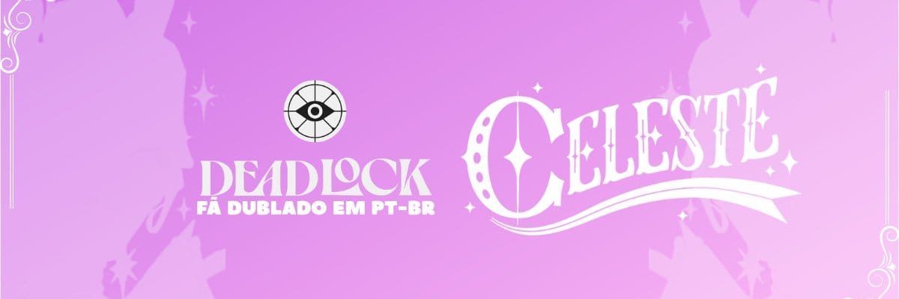

  

<h1 align="center">✦ Duas vozes. Um universo que nunca dorme. ✦</h1>

  <em>Uma cidade amaldiçoada. Duas vozes. Uma nova interpretação.</em> 
  Fã dublagem independente de <strong>Deadlock</strong> em português brasileiro, por <strong>Kaike Alves</strong>.

---

São três da manhã em Nova York. A névoa sobe do asfalto, um trem passa lá em cima no elevado e, numa
rua que não aparece no mapa, uma loja continua com a luz acesa. Do outro lado da cidade, uma urna velha
espera alguém para carregá-la… e ela **não para de falar**.

Esta página é essa noite. Ela foi feita para apresentar ao
**Projeto Celeste — Deadlock Fã Dublado em PT-BR** dois personagens que não são heróis, mas sempre
roubam a cena.

---

## ✦ As vozes

| | Registro | Personagem | O que você vai ouvir |
| :-: | --- | --- | --- |
| 🕯️ | **Nº 001** | **O Vendedor** · *The Shopkeeper* | As falas dele para cada herói, com atalho para pular direto para Abrams, Bebop, Haze, Lash, Paradox, Yamato e outros |
| ⚱️ | **Nº 002** | **A Urna Espiritual** · *Soul Urn* | As falas dela: reunindo almas, esperando, sendo coletada, sob fogo, largada no chão e a entrega |

---

## ✦ Por que essa página existe

Sempre fui apaixonado por personagens que trazem humor e personalidade, aqueles um pouco bobos que
você nunca esquece. Em Deadlock, dois deles me chamaram atenção: o Vendedor e a Urna. Não são
protagonistas, mas têm algumas das falas mais engraçadas do jogo.

Até hoje dublei só por diversão, com amigos. Nada profissional, mas sempre foi algo que admirei muito.
Esta demonstração é a minha forma de mostrar esse interesse ao Projeto Celeste e, quem sabe, ter a
chance de colaborar com a equipe.

---

## ✦ O que tem nessa cidade

**🎮 Uma tela de título.** Como no jogo: Nova York ao entardecer e *"pressione qualquer tecla para
começar"*. A música do menu de Deadlock entra, fitas de energia verde varrem a tela, e um menu de
jogo leva você para dentro da cidade. Depois, a trilha segue baixinha ao fundo e se cala sozinha
quando uma dublagem começa.

**🌃 Uma capa de cinema.** Uma Nova York noturna, com holofotes, trem elevado, névoa e uma lua que
vigia a cidade. Presta atenção no céu.

**📁 Um arquivo secreto.** A apresentação é uma ficha de papel envelhecido, com clipe, carimbo e o
desenho de um microfone antigo. A gravação que ficava ali foi retirada: no lugar, uma fita de isolamento
de "arquivo encerrado".

**🕯️ Uma loja escondida.** Vitrine com letreiro dourado, frascos brilhando e uma lâmpada que
**acende conforme a voz do Vendedor**.

**⚱️ Uma rua que some no escuro.** Postes desaparecendo na névoa. Quando a Urna fala, ela brilha e as
**almas começam a orbitar**.

**🌙 Dia e noite.** Dá para alternar entre a madrugada e a mesma cidade ao amanhecer.

Cada áudio tem o seu próprio player, com atalhos para pular direto para cada herói ou situação. Nada
toca sozinho: a cidade espera você apertar o play.

---

  
    ✦ Projeto independente de fã, sem vínculo oficial ou patrocínio da Valve ou do Projeto Celeste. 
    Deadlock, seus personagens e demais propriedades intelectuais pertencem aos respectivos titulares. 
    Os cenários desta página são ilustrações originais e não representam artes oficiais do jogo. 
    As falas do Vendedor e da Urna são as originais do jogo (© Valve). Esta página começou como um teste de
    fã dublagem, e as gravações de voz feitas para ele foram retiradas. 
    ♪ Música de fundo: <em>Main Menu — Original Theme</em> (music_title_155bpm) · Deadlock © Valve Software.
    Trilha apresentada pelo canal <a href="https://www.youtube.com/@DeadlockAir">Dead Air</a>, com edição de
    <a href="https://www.youtube.com/@DeadAirJacky">Jacky Powers</a> e design de
    <a href="https://www.youtube.com/@DeadAirDaisy">Daisy Powers</a>. ✦
  

<em>A cidade nunca dorme. Eu também não.</em>

